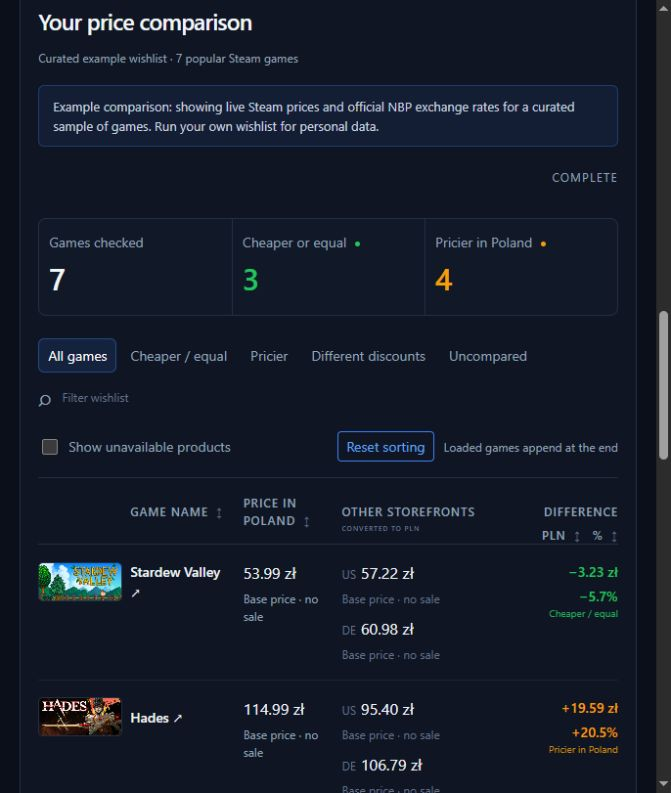

# Steam Currency Comparer

**Version: 0.1.0-beta.1** · Public source beta for local use.

[GitHub repository](https://github.com/instant-results/steam-currency-comparer)

Compare the prices of games on your public Steam wishlist, or browse featured
developer and publisher catalogs, across regional Steam storefronts. Choose a baseline currency and one or two other storefronts; the app
converts their prices using National Bank of Poland (NBP) exchange rates and shows
which games cost more or less in your baseline storefront, including current sales.

This is a **locally run web app**: a small Python server runs on your computer,
and you use it in your browser. You need Python and a terminal to set it up, but
no programming knowledge to use it. There is no hosted service or packaged
installer yet. Independent project; not affiliated with Valve or Steam.

## Preview



Live seven-game example captured on 2026-09-23 with version 0.1.0-beta.1;
the screenshot shows part of the completed results. Prices and exchange rates
change over time. No personal Steam profile is used.
[View the app title and setup screen](docs/images/app-overview.jpg).

## What it does

- Compares Poland (PLN), the United States (USD), Germany (EUR), Norway (NOK),
  and the United Kingdom (GBP). Any can be the baseline; the default is PLN
  against USD and EUR.
- Shows regional final prices, discounts, converted prices, and absolute and
  percentage differences.
- Loads games by Your Rank, Date Added, or Name, with search, filters, and
  result sorting once results arrive.
- Caches prices and exchange rates, labels stale results, and lets you cancel
  or retry a comparison.
- Exports loaded results to CSV, with wishlist attribution optional.
- A **Developers & publishers** tab compares three featured games each from
  Supergiant Games, CD PROJEKT RED, and Devolver Digital. Expand their Steam
  catalogs to compare more products without providing a wishlist.
- A **Developers & publishers** tab compares three featured games each from
  Supergiant Games, CD PROJEKT RED, and Devolver Digital. Expand their Steam
  catalogs to compare more products without providing a wishlist.

The app compares prices for information. It does not change your Steam account's
country, modify your wishlist, or purchase games. Displayed regional differences
are not a guarantee that you can buy at another storefront's price.

## Run locally

### Requirements

- **Python 3.10 or newer**, with pip and support for virtual environments.
- A web browser and internet access to Steam and NBP.
- Your **public Steam wishlist**, or use the built-in example to try the app.

No Steam sign-in, Steam cookies, or API key is needed when using a numeric
SteamID64 or a `/profiles/` URL. Custom `/id/` URLs need optional API-key setup.
Node.js is only needed for frontend tests, not to run the app.

### 1. Get the project

Download the repository using **Code → Download ZIP** on GitHub and extract it,
or clone it with Git:

```sh
git clone https://github.com/instant-results/steam-currency-comparer.git
cd steam-currency-comparer
```

Open a terminal in the extracted or cloned project folder (the folder containing
`serve_web.py` and `requirements.txt`).

### 2. Install and start

Use the commands for your operating system. A virtual environment keeps the
project's dependencies separate from other Python applications. These commands
use its Python directly, so activation is not required.

**Windows — PowerShell**

```powershell
py -3 -m venv .venv
.\.venv\Scripts\python.exe -m pip install -r requirements.txt
.\.venv\Scripts\python.exe serve_web.py
```

If `py` is unavailable but Python is installed, use `python -m venv .venv`
for the first command. Ensure that interpreter is Python 3.10 or newer.

**macOS / Linux — terminal**

```sh
python3 -m venv .venv
.venv/bin/python -m pip install -r requirements.txt
.venv/bin/python serve_web.py
```

If your Linux installation reports that `venv` or `ensurepip` is missing,
install your distribution's Python virtual-environment package, then retry.

### 3. Open the app

Open **[http://127.0.0.1:8765](http://127.0.0.1:8765)** in your browser.

1. Enter your 17-digit SteamID64 or your numeric Steam profile URL, or click
   **Try an example comparison** to compare seven selected games without a profile.
2. Select a baseline and one or two comparison currencies.
3. Choose the loading order and click **Compare regional prices**.

The example uses live Steam prices and NBP exchange rates, so it also needs
internet access. A numeric profile URL has the form
`https://steamcommunity.com/profiles/YOUR_STEAMID64/`; replace `YOUR_STEAMID64`
with your actual ID. The numeric ID `76561198000000000` used in documentation
and tests is a placeholder, not a supplied demo profile.

Keep the terminal open while using the app. Stop it with **Ctrl+C**. On later
visits, run only the final server command for your operating system; repeat
installation if the project's dependencies change.

## What to expect

- **Public wishlists only**, with at most 1,000 games per comparison in the web app.
- **Large wishlists take time.** Steam requests are paced at 1.5-second intervals.
  A cold 100-game comparison across three storefronts needs roughly 7½ minutes
  of request spacing, plus network delays and retries. Cached prices reduce work.
- **Name order may start slowly:** it first fetches missing game names from the
  baseline storefront. Your Rank is the default.
- **Unavailable products are hidden by default.** Enable **Show unavailable
  products** to reveal them. Technical failures remain visible.
- **Results are temporary.** Refresh reconnects in the same tab; closing the tab
  or restarting the server loses job access. Server results expire after an hour;
  completed creator results saved in the tab remain visible until refreshed or closed.
- **Prices are snapshots.** Regular prices normally refresh after an hour, sale
  prices after 15 minutes, and exchange rates after 24 hours. Stale fallback is
  labeled when available.

The comparison uses final prices, including sales, and NBP currency conversion.
It does not adjust for tax differences or payment-provider fees. Germany is the
selected EUR storefront, not a guarantee of prices across the euro area.
See the [comparison methodology](docs/USAGE.md#rates-and-comparison-methodology)
for the exact interpretation of results.

## Troubleshooting

| Problem | What to check |
| --- | --- |
| Python is not found | Install Python 3.10+ and reopen the terminal. On Windows, try `python` if `py` is unavailable. |
| Missing Python module | Run the dependency-install command above, then start the server using that same virtual environment. |
| No public wishlist found | Check your wishlist's visibility and use your actual numeric SteamID64. |
| Custom profile URL cannot be resolved | Use a numeric `/profiles/` URL or configure your own optional Steam Web API key. |
| Port 8765 is already in use | Stop the existing instance or append `--port 8766` to the server command and open `http://127.0.0.1:8766`. |
| Network access denied | Allow the server outbound access through your firewall or execution environment, then restart it. |

Custom profile URL setup is covered in the [usage guide](docs/USAGE.md#custom-steam-profile-urls).
The project does **not** automatically load `.env`; `.env.example` documents
settings that must be supplied as environment variables.

## Local data and privacy

The web app keeps its price cache and diagnostic logs in `.steam-price-polisher/`
by default. The cache stores regional prices and exchange rates, not
profile-to-wishlist links. Logs exclude profiles, API keys, cookies, and job tokens.
The browser tab stores the current profile and job-access token in session storage,
plus separate creator results and catalog positions. Private wishlist results and
profile attribution are held temporarily in server memory.

Steam and NBP receive the requests needed for the comparison, and the browser
loads game artwork directly from Steam's image CDN. Running locally does not mean
running offline. The web app never reads local `wishlist.txt` or `STEAM_COOKIE`.
Keep local data, populated environment files, and credentials out of Git.

## Versioning

The release version is defined in `steam_price_polisher/version.py` and shown
in the app header, server startup message, and `/api/health` response.
`0.1.0-beta.1` identifies the first beta of the 0.1.0 release. Increment the beta
suffix for later prereleases; use `0.1.0` for the corresponding stable release.
Update this README and the [changelog](CHANGELOG.md) when changing the version. Git tags and
GitHub releases are created separately when a release is ready to publish.

## For developers

The display name is Steam Currency Comparer. Existing filenames, the
`steam_price_polisher` package, and `STEAM_PRICE_POLISHER_*` settings retain
their original names for compatibility.

The backend uses Python WSGI and SQLite; the frontend is plain HTML, CSS, and
JavaScript with no build step. Wishlist retrieval, regional pricing, exchange
rates, comparison arithmetic, and request pacing are separate modules in
`steam_price_polisher/`. Browser assets are in `web/` and regression tests in `tests/`.

Run the Python suite with your virtual environment's interpreter:

```powershell
# Windows
.\.venv\Scripts\python.exe -m unittest discover -v
```

```sh
# macOS / Linux
.venv/bin/python -m unittest discover -v
```

Frontend checks require Node.js with its built-in test runner:

```sh
node --test tests/test_web_render.cjs
node --check web/app.js
```

- [Usage and technical reference](docs/USAGE.md): CLI commands, sale-price handling,
  CSV fields, sorting, caching, diagnostics, and methodology.
- [Deployment guidance](DEPLOYMENT.md): requirements and limitations for future
  public hosting. The local launcher is not the public deployment entry point.
- [Current project context](PROJECT_CONTEXT.md) and [collaboration guidance](AGENTS.md).
- [Sorted wishlist API research](docs/STEAM_SORTED_WISHLIST_API.md): proposed
  integration, not an implemented feature.
